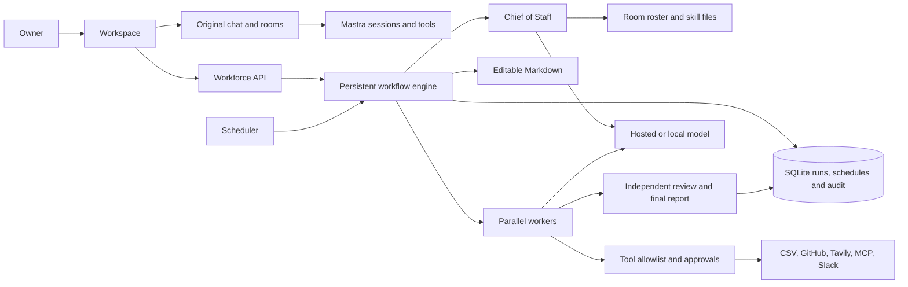

# OpenCrewBot 2.0 architecture

OpenCrewBot remains a single-owner, loopback-only Next.js app. Agent profiles, rooms, chats and Workforce state share the upstream LibSQL database. Direct chats and @mention rooms still use Mastra AgentController, its conversation storage, and the existing connection screens.

## Execution

1. The server stores the instruction, room, project, attachment and execution mode. Model planning passes the roster, available skills and allowed tools to the configured model. Rules planning routes supported tasks and supplied URLs deterministically. In Live mode its workers still use the configured model and actual tools.
2. The server validates task IDs, arguments, assignments and dependencies, rejects cycles and creates an independent review plus a report task. Sequential mode adds edges between consecutive tasks. A room can use the ordinary chat and the workflow engine independently.
3. Up to four workstreams across active runs execute concurrently. Each receives relevant memory, permitted tool results and dependency handoffs. The reviewer can ask one question, delegate follow-up work or request independent verification from an eligible peer. The final report waits for the peer answer. Rules reports assemble the worker outputs, review and source receipts locally.
4. Every task transition and approval decision persists before the server publishes a Workforce progress event. The dashboard also refreshes periodically while showing active work. The engine retries transient errors up to three attempts with exponential backoff. It bounds planning, model and tool calls and records start and finish times, errors and usage.
5. A revised instruction creates a linked successor carrying completed handoffs. Active work on the previous run is cancelled, and its audit history stays accessible. Restart recovers undispatched work and preserves pending approvals. A dispatched write with no receipt remains failed for the operator to reconcile. There is no automatic replay of a possibly completed write.

The scheduler supports intervals and manual runs. It starts with the Node server. A unique schedule/slot key and a SQLite batch prevent a due-slot insertion from advancing the schedule without creating a run. After downtime it runs one overdue slot and then resumes the interval.

## Permissions and data

Workforce checks both the global tool switch and the agent allowlist before dispatch. Ask First gates every external tool call. Controlled Access runs explicitly pre-approved read tools. Full Access runs allowed reads automatically. GitHub issue creation and Slack posting always require approval for the exact persisted payload. The model has no direct access to credentials or a generic shell. A request and approval do not dispatch a tool until worker policy checks finish. The audit table has triggers against application updates and deletes. The machine owner can still administer or replace the database file.

The upstream Markdown files remain in `data/workspaces/<botId>/MEMORY.md`. Room, project, preferences, decisions and history use the same Markdown file engine under `data/workspaces/wf-*`. Workers reload files per task. UI edits record the editing actor and date in a separate provenance file, and historical entries identify their source run and purpose. Markdown changed directly on disk is read on the next task. The UI cannot attribute edits made outside the application.

Workforce credentials come from environment variables. Redaction is best-effort, so keep secrets out of instructions, CSV data and memory. Configured hosted models receive relevant context including permitted memory and tool evidence. The original chat connectors keep their upstream behavior, including server-side SQLite storage for custom MCP header and token values.

## Dependency and cost breakdown

| Component | Configuration and cost |
| --- | --- |
| Local mock mode, SQLite and CSV processing | No service credentials or API charges. Disk usage grows with run history and attachments. |
| Nebius or OpenAI-compatible hosted model | Server-side credentials; billed by provider and model. Set optional USD per-million-token rates with `WORKFORCE_PRICES`. |
| Local model endpoint | Server-side OpenAI-compatible endpoint such as Ollama. Uses your machine's memory, compute and storage. |
| GitHub | Public reads use the GitHub REST API and its unauthenticated limit. Write requires a fine-grained token for a selected test repo with Issues write permission. |
| DeepWiki and Microsoft Learn | Public read-only MCP services. Availability and rate limits depend on their operators. |
| Public HTTPS reads | Keyless extraction of supplied public text URLs. Bounds downloads and request time and resolves public IPv4 addresses only. |
| Tavily | Optional general web search and extraction account. Provider quotas apply. |
| Slack | Optional workspace installation and bot token. Posting also depends on channel membership and workspace policies. |
| Original chat integrations | Composio, Browserbase, Jev and Tavily retain their upstream account, plan and usage requirements. |

The app stores provider-reported token counts and estimates costs from your configured rates. Unknown rates remain unpriced. The output token limit is per call. Retries and provider fallback may incur additional charges. Failed provider calls with no usage receipt are absent from the totals.

The fork retains the upstream MIT license and Studio1HQ attribution. Public HTML parsing uses Cheerio, which is MIT-licensed. The optional local stack uses MIT-licensed llama.cpp and Apache-2.0-licensed Qwen3 1.7B GGUF weights. Install those separately. [Cheerio license](https://github.com/cheeriojs/cheerio/blob/main/LICENSE) · [llama.cpp license](https://github.com/ggml-org/llama.cpp/blob/master/LICENSE) · [Qwen model card](https://huggingface.co/Qwen/Qwen3-1.7B-GGUF).

## Known boundaries

- Local single-process execution. Shared hosting requires authentication, tenant isolation, secret management and a distributed job lease.
- Live planning generates a bounded graph. Review can add one peer follow-up per run. Amend the instruction when a run needs human clarification.
- Keyless research reads static text from supplied public URLs. JavaScript-only content, PDFs and sites that block programmatic readers may require a different source. General web discovery uses the optional Tavily integration.
- File analysis accepts UTF-8 CSV exports. Presentation Creation produces a Markdown storyboard. The extension does not produce PowerPoint or ingest native Excel workbooks.
- Recurrence uses a fixed interval. A run can wait on approvals, including scheduled reads in Ask First mode.
- Worker tools are a fixed allowlist. Arbitrary user-configured MCP servers and Composio apps remain available in the original chat surface.
